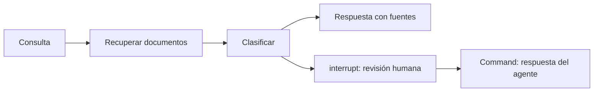

# Helpdesk con intervención humana

RAG sobre la base de conocimiento del curso, clasificación estructurada y dos rutas:
respuesta automática con fuentes o pausa para recibir la respuesta de un agente.



```powershell
uv run python -m apps.helpdesk_system.setup_rag
uv run python -m streamlit run apps/helpdesk_system/app.py --server.address 127.0.0.1
```

También puedes indexar desde la interfaz. Prueba una consulta estándar («¿Cómo
restablezco mi contraseña?») y una que requiera decisión interna («Necesito un reembolso
excepcional»). La clasificación depende del modelo y puede requerir revisión.

Los tickets y checkpoints se conservan bajo `local_data/helpdesk/`. Reinicia la aplicación,
selecciona un ticket pendiente y escribe la respuesta del agente para reanudarlo.
El grafo usa `interrupt` y `Command(resume=...)`; terminar en END no equivale a pausarlo.

`graph.py` contiene el flujo y acepta recuperación, modelo y checkpointer inyectados.
`service.py` delimita las conexiones SQLite y mantiene el catálogo de tickets.
La clasificación usa los fragmentos originales, no una respuesta generada como evidencia.
No presenta una puntuación de «confianza» basada en coincidencias de palabras.

Es una consola local sin autenticación ni envío real de notificaciones a agentes.
La base `knowledge_base/` describe un producto ficticio para practicar soporte.

[Volver al curso](../../README.md)
