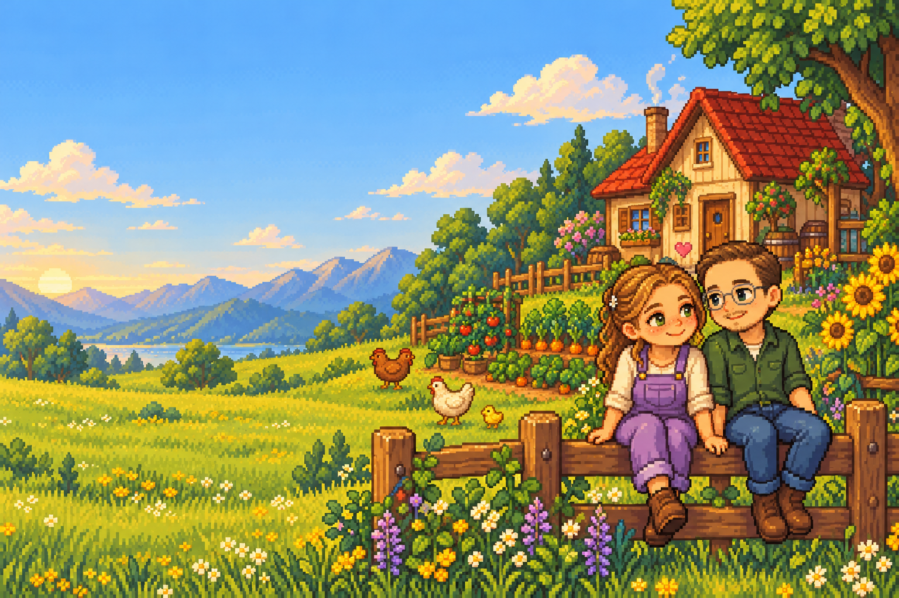

# Stardew Valley Wiki para Ligia 🌻

Una wiki de fans en español, hecha por Oscar para Ligia mientras aprende a jugar a **Stardew Valley**. Una granja ilustrada, nuestros personajes en pixel art y un pequeño rincón con corazones para consultar el juego sin depender de las caídas de la wiki oficial.



## Qué incluye

- **184 fichas locales:** 54 guías, 43 cultivos, 53 peces y los 34 habitantes con amistad.
- Guías sobre primeros pasos, energía, habilidades, cultivos, animales, pesca, relaciones, minas, artesanía, cocina, estaciones, Centro Cívico e Isla Jengibre.
- Buscador que ignora tildes y mayúsculas, y también encuentra regalos y términos dentro de las guías.
- Catálogos con filtros por estación, clima y candidatos al matrimonio.
- Calendario de 28 días con cumpleaños, festivales y selector del día de la partida.
- Calculadora de cosechas hasta el final de la estación: crecimiento, rebrote, compra de semillas y rendimiento mínimo garantizado.
- Favoritos, metas y notas personales guardados en el navegador; exportación del cuaderno a texto.
- Diseño adaptable a móvil, navegación por teclado, atajo `/` para buscar y respeto de movimiento reducido.
- Ilustraciones originales de Ligia y Oscar generadas a partir de sus fotografías. Las fotos originales **no se distribuyen**.

## Tecnología

React 19, Vite 7 y Tailwind CSS 4. Lucide para iconos; Nunito y Pixelify Sans servidas desde el propio proyecto. No hay servidor de datos, claves API, cuentas ni dependencias externas en tiempo de consulta.

## Desarrollo local

Requiere **Node.js 22.12 o posterior** y npm. Desde esta carpeta:

```sh
npm ci
npm run dev
```

Abre la dirección que muestra Vite, normalmente `http://localhost:5173/`.

```sh
npm test         # Datos, búsqueda, calendario y cálculos de cosechas
npm run build   # Compilación de producción en dist/
npm run preview # Servir la compilación localmente
```

No abras `dist/index.html` directamente con `file://`: utiliza un servidor HTTP.

## Publicación

El proyecto utiliza `base: './'` y rutas con hash, por lo que puede servirse en una subcarpeta sin reglas especiales de reescritura. Publica el contenido de `dist/` en un alojamiento estático. El workflow del repositorio `.github/workflows/ligia-wiki.yml` prepara la web para GitHub Pages en `/coding-playground/stardew-valley-wiki-para-ligia/`.

## Estructura

```text
public/assets/        Ilustraciones locales
src/App.jsx          Navegación, páginas y herramientas
src/styles.css       Diseño, accesibilidad y adaptación móvil
src/lib.js           Búsqueda, cálculos y almacenamiento
src/data/guides.js   Guías originales y categorías
src/data/catalog.js  Cultivos, peces y habitantes
tests/               Comprobaciones de datos y lógica
docs/                Fuentes, créditos y prompts de las ilustraciones
```

## Contenido, fuentes y alcance

La selección está orientada al **juego base 1.6**, sin mods. No es una réplica de los más de 1.800 artículos de la wiki oficial: aún faltan objetos, recetas exhaustivas, horarios de cada vecino, trampas de pesca, variantes de Qi, lotes remezclados y otros detalles avanzados. La página «Fuentes y créditos» explica estas limitaciones dentro de la aplicación.

Cada ficha incluye la URL de su fuente en [Stardew Valley Wiki](https://stardewvalleywiki.com/Stardew_Valley_Wiki); también se consultó la [versión española](https://es.stardewvalleywiki.com/Stardew_Valley_Wiki). Los textos de las guías son resúmenes originales. No se ha copiado el contenido íntegro de las wikis ni se han incluido recursos extraídos del juego.

Los precios son base, sin calidad ni profesiones. `seed: null` significa que no se ha fijado un precio de compra, **no** que las semillas sean gratis. La calculadora contempla una estación, riego diario y rendimiento mínimo garantizado; no simula fertilizantes, cosechas aleatorias, casillas de agua, invernadero ni continuidad a otra estación. La compra inicial se cuenta aunque el cultivo no llegue a madurar.

Fecha de consulta editorial: **25 de octubre de 2026**. Algunas fuentes devolvían errores 503, por lo que también se contrastaron sus resultados indexados. Las referencias permiten comprobar o actualizar cada dato.

Para ampliar el contenido, añade entradas con un `id` único y su `source` a los archivos de `src/data/`; las páginas, búsqueda y catálogos las incorporan automáticamente. Ejecuta `npm test` después de modificar los datos.

## Datos personales y disponibilidad

Todo el texto, fuentes tipográficas e imágenes se sirven desde esta web. Si la wiki oficial cae, las fichas siguen disponibles. La primera carga y las recargas necesitan que el alojamiento de esta web esté accesible; **no se instala un modo sin conexión**.

Favoritos, estación, día, metas y notas se guardan en `localStorage` con el prefijo `ligia-v1-`. No salen del dispositivo ni se sincronizan entre navegadores. Borrar los datos del navegador elimina esos guardados. El cuaderno permite descargar una copia de las notas y metas.

## Créditos

Stardew Valley pertenece a **ConcernedApe**. Proyecto de fans independiente, no oficial y sin afiliación. Las ilustraciones de la pareja son generadas para este proyecto, no sprites oficiales. Tipografías bajo SIL Open Font License; Lucide bajo ISC. Detalles en [docs/CREDITS.md](docs/CREDITS.md).

Hecho con cariño, para compartir una aventura más. **Oscar ♥ Ligia**
